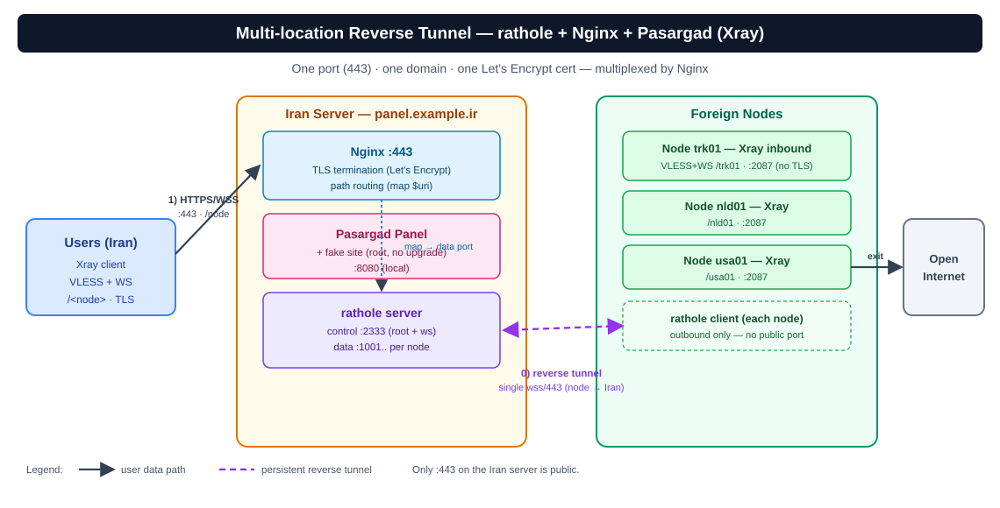

# معماری جامع — سه نقش، اصول طراحی و استحکام امنیتی (v1.8.7)

`rathole-manager` یک سامانه پیشرفته، ماژولار و امن برای مدیریت تونل‌های معکوس چند-موقعیتی بر پایه‌ی **rathole + Nginx** است. یک سرور ایران (پشت یک دامنه، یک گواهی معتبر SSL و پورت ۴۴۳) ترافیک را دریافت کرده و به نودهای خارجی که با تونل معکوس به آن متصل هستند هدایت می‌کند.

---

## ۱. سه نقش و ساختار اجرایی

| نقش | ابزار اجرایی | زبان / وابستگی | وظایف و مسئولیت‌ها |
| :--- | :--- | :--- | :--- |
| **پنل ایران** | [`ratholectl`](../rathole-manager/ratholectl) | Bash (بدون وابستگی) | مدیریت rathole-server و Nginx، نگهداری state نودها، تولید امن کانفیگ‌های `server.toml` و `rathole.conf`، مدیریت گواهی‌های SSL و دیواره ضدپروب. |
| **نود خارج** | [`ratholenode`](../rathole-manager/ratholenode) | Bash (بدون وابستگی) | مدیریت rathole-client، اتصال تونل معکوس به سرور ایران، تولید `client.toml` و نگاشت پورت‌ها به اینباندهای Xray/V2Ray. |
| **هاب مرکزی** | [`ratholehub/hub.py`](../rathole-manager/ratholehub/hub.py) | Python 3 (فقط stdlib) | داشبورد تحت وب گرافیکی و REST API جهت مدیریت چند سرور ایران و نودها با اتصال امن SSH، اعتبارسنجی آرگومان‌ها و ثبت لاگ‌های ممیزی. |

اسکریپت مشترک [`common.sh`](../rathole-manager/common.sh) شامل توابع بنیادین امنیتی (`umask 077`، قفل‌های fail-closed، اعتبارسنجی پورت‌ها، تیونینگ هسته BBR و دیواره دفاعی سایت فیک) توسط تمام ابزارها فراخوانی می‌شود.

---

## ۲. اصول طراحی و استحکام امنیتی (Hardened Core)

### الف) چرخه اتمیک: State → Regenerate → Hot-Reload
هیچ فایلی نباید دستی ویرایش شود. تمامی تغییرات از چرخه تراکنشی عبور می‌کنند:
1. **تراکنش اتمیک (`rth_state_tx`):** هر تغییر در فایل `state.json` ابتدا در یک فایل موقت امن با دسترسی `0600` نوشته شده و پس از اعتبارسنجی JSON، به صورت اتمیک جایگزین می‌گردد.
2. **قفل‌گذاری Fail-Closed (`rth_with_lock`):** در صورت بروز هرگونه تداخل یا عدم امکان باز کردن قفل، عملیات متوقف شده و از اجرای بدون قفل یا بروز Race Condition پیشگیری می‌شود.
3. **تست و بارگذاری بدون قطعی (Zero-Downtime Hot-Reload):** کانفیگ با حفظ inode نوشته شده تا مکانیزم `config_watcher` در rathole بدون قطع کانکشن‌های فعال کاربران، تغییرات را اعمال کند. در Nginx نیز ابتدا تست نحوی `nginx -t` اجرا شده و در صورت شکست، کانفیگ به نسخه پشتیبان سالم (`.rathole-good.bak`) بازگردانده می‌شود.

### ب) هم‌ترازی سه‌گانه: Path == نام نود == اینباند Xray
در معماری لایه ۷، نام هر نود (مانند `trk01`) هم‌زمان سه نقش ایفا می‌کند:
- مسیر URL کاربر: `https://domain.com/trk01`
- کلید نگاشت در Nginx: `map $uri $backend_port`
- مسیر اینباند VLESS/VMess در نود خارجی: `path: /trk01`

---

## ۳. دفاع فعال در برابر فیلترینگ و اسکنرهای هوشمند (Active Defense)

در این معماری، فیلترچی و ربات‌های اسکن شبکه با دیواره‌های هوشمند چندلایه مواجه می‌شوند:
- **پاسخ شبیه‌سازی وب‌سرور واقعی (Fake Web 200 OK):** درخواست‌های متفرقه یا اسکن‌های ریشه (`/`) به جای خطاهای مشکوک ۵۰۲ یا Connection Refused، پاسخ یک وب‌سایت شرکتی مدرن با کد وضعیت `200 OK` را دریافت می‌کنند.
- **مسیر پنهان کنترلی (Hidden Control Path):** کانال اتصال نودها به سرور ایران از طریق یک مسیر استتارشده با هدرهای استاندارد WebSocket برقرار می‌شود.
- **تفکیک بدون بافر XHTTP (SplitHTTP):** عبور استریم پیوسته با غیرفعال‌سازی کامل بافرینگ جهت محافظت در برابر بازرسی عمیق بسته‌ها (DPI).

---

## ۴. حالت‌های متنوع ترانزیت (Transport Modes)

سامانه از شیوه‌های مختلف عبور ترافیک متناسب با شرایط شبکه پشتیبانی می‌کند:
1. **WebSocket + TLS (پیش‌فرض):** استتار استاندارد پشت پورت ۴۴۳ وب‌سرور Nginx.
2. **XHTTP (SplitHTTP):** ترافیک مقاوم و پیوسته وب بدون قطعی تحت سناریوهای شدید اختلال.
3. **حالت گیمینگ لایه ۴ (Game 0-RTT Vision):** عبور مستقیم استریم TCP/UDP بر اساس SNI توسط ماژول Stream در Nginx، بدون دخالت لایه ۷ و بدون رمزگشایی در سرور ایران (حداقل پینگ و تاخیر صفر).
4. **KCP (UDP+FEC):** ترانزیت ضد پکت‌لاس با الگوریتم اصلاح خطای Reed-Solomon شبیه‌ساز پروتکل QUIC گوگل روی پورت ۴۴۳.
5. **Noise & Backhaul (SMUX):** کانال‌های اختصاصی با رمزنگاری پیشرفته ChaCha20-Poly1305 و مالتی‌پلکسینگ کانکشن‌ها.
6. **Direct-IP & Reverse Proxy:** هدایت بر اساس هدر اختصاصی بدون نیاز به دامنه، یا پروکسی معکوس برای سرویس‌های مستقل.

---

## ۵. مستندات تفصیلی و مراجع تکمیلی

- [راهنمای جامع حالت‌های ترانزیت (`transport-modes.md`)](transport-modes.md)
- [مسیر دقیق جریان بسته‌ها (`traffic-flow.md`)](traffic-flow.md)
- [مدل امنیتی و معماری هاب مرکزی (`hub.md`)](hub.md)
- [بهینه‌سازی کارایی و تیونینگ شبکه (`performance.md`)](performance.md)
- [راهنمای نصب دستی گام‌به‌گام (`install-manual.fa.md`)](install-manual.fa.md)
- [مرجع کامل خط فرمان در ویکی مخزن](https://github.com/oldrcesupport/rathole-tunnel/wiki/CLI-Reference)
