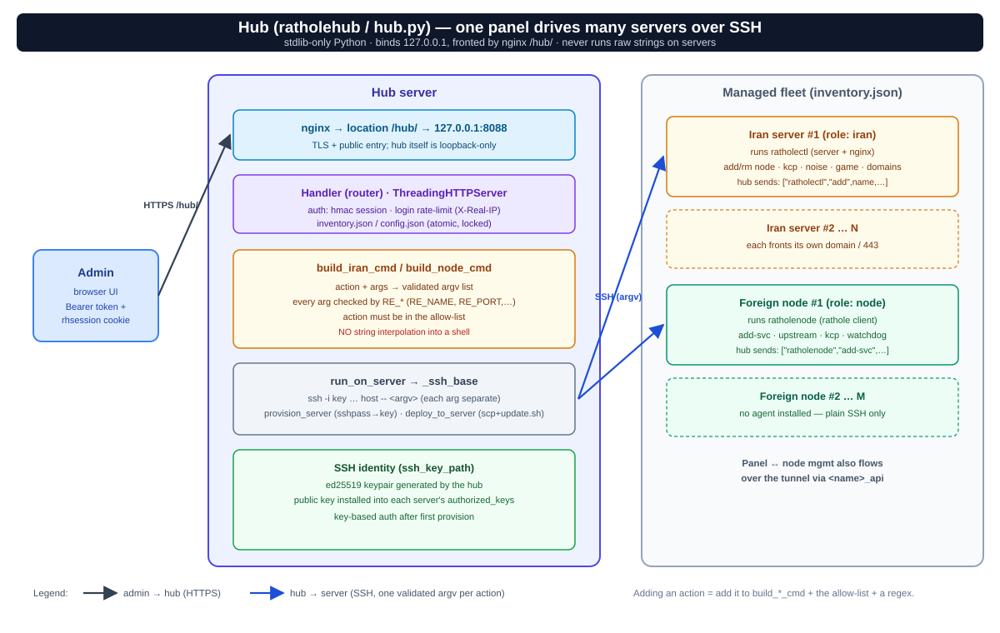

# ratholehub — پنل وب متمرکز و رابط برنامه‌نویسی (REST API + UI)

`ratholehub` پنل مرکزی وب و کنسول مدیریتی چند سروره است که به شما امکان می‌دهد چندین سرور ایران و نودهای خارج را به صورت یکپارچه و گرافیکی مدیریت کنید، بدون اینکه هیچ پورت اضافه یا سرویس آسیب‌پذیری روی سرورهای متصل باز شود.



---

## ۱. ویژگی‌ها و اصول طراحی

- **معماری بدون Agent (Agentless over SSH):** پنل تنها روی یک سرور (معمولاً سرور اصلی ایران) مستقر می‌شود و دستورات را از طریق کانال امن **SSH (با احراز هویت کلید عمومی)** روی بقیه سرورها اجرا می‌کند. نیازی به نصب ایجنت روی نودها نیست.
- **بدون وابستگی خارجی (Zero Dependencies):** توسعه‌یافته به صورت ۱۰۰٪ استاندارد با کتابخانه پیش‌فرض Python 3 (بدون نیاز به `pip` یا پکیج‌های ثالث).
- **امنیت احراز هویت ارتقایافته (PBKDF2-HMAC-SHA256):** رمزهای عبور کاربران با الگوریتم قدرتمند PBKDF2 با ۱۰۰,۰۰۰ راند هش می‌شوند و هش‌های قدیمی به صورت خودکار شناسایی و ارتقا می‌یابند.
- **حفاظت در برابر جعل IP (Anti-Spoofing Rate Limiting):** محدودکننده درخواست‌ها (Rate Limiter) هدرهای `X-Real-IP` و `X-Forwarded-For` را تنها از پروکسی‌های محلی معتبر (`127.0.0.1` و `::1`) پذیرفته و مانع از دور زدن محدودیت ورود با جعل هدر می‌شود.
- **حذف و سانسور اطلاعات حساس (Secret Redaction):** کلیه توکن‌ها، رمزهای عبور، کلیدهای خصوصی و پارامترهای حساس پیش از ذخیره‌سازی در لاگ‌های ممیزی (`audit.log`) توسط تابع `redact_cmd()` به شکل اتوماتیک سانسور (`***REDACTED***`) می‌شوند.
- **ذخیره‌سازی اتمیک تنظیمات (`save_json`):** تنظیمات سرورها و اینونتوری با استفاده از نام‌های موقت یکتا، دسترسی محافظت‌شده `0600` و تعویض اتمیک (`os.replace`) نوشته می‌شوند تا قطعی برق یا خرابی هارد منجر به فایل‌های ناقص یا خالی نشود.

---

## ۲. راه‌اندازی و دسترسی

### الف) نصب
```bash
cd /root/rathole-manager/ratholehub
sudo bash install-hub.sh
```
اسکریپت نصب به طور خودکار کلیدهای لازم را تولید کرده و رمز عبور پنل را دریافت می‌کند.

### ب) دسترسی امن به پنل
امن‌ترین روش دسترسی بدون باز کردن پورت جدید روی اینترنت، اتصال از طریق تونل امن SSH از سیستم شخصی است:
```bash
ssh -L 8088:127.0.0.1:8088 root@<IRAN_IP>
# ورود از مرورگر: http://localhost:8088
```
یا فعال‌سازی دسترسی وب پشت Nginx تحت دامنه سرور ایران:
```bash
sudo ratholectl hub on 8088
# دسترسی: https://<domain>/hub/
```

---

## ۳. بخش‌های رابط کاربری (UI)

رابط کاربری مدرن هاب در پوشه `ui/` شامل بخش‌های زیر است:
- **داشبورد (`#/dashboard`):** کارت وضعیت کلیه سرورهای متصل، شاخص دسترسی آنلاین، دکمه افزودن و راه‌اندازی خودکار نود جدید (Provisioning).
- **صفحه سرور (`#/server/<name>`):** جدول مدیریت نودها، سوییچ ترانزیت‌های فعال (KCP، Plain، Noise، Backhaul) و انتخاب حامل اختصاصی برای هر نود.
- **مسیریابی و ترافیک (`#/routing`):** دیاگرام بصری جریان بسته از کاربر تا اینترنت آزاد.
- **لاگ‌های ممیزی (`#/audit`):** ثبت دقیق کلیه اقدامات انجام‌شده همراه با زمان، کاربر، سرور هدف و کد خروجی بدون افشای سکرت‌ها.
- **تنظیمات هاب (`#/settings`):** مدیریت زبان، تنظیمات رفرش خودکار، تغییر توکن‌های API و تنظیمات گواهی SSL.

---

## ۴. مرجع REST API هاب

کلیه درخواست‌های API نیازمند ارسال هدر `X-API-Token` یا کوکی احراز هویت سشن هستند:

| متد | مسیر (Endpoint) | کاربرد و توضیحات |
| :--- | :--- | :--- |
| `GET` | `/api/status` | وضعیت سلامت هاب و اطلاعات پایه |
| `GET` | `/api/servers` | لیست سرورها در inventory همراه با وضعیت اتصال |
| `POST` | `/api/servers` | افزودن سرور جدید به inventory |
| `DELETE` | `/api/servers/<id>` | حذف سرور از لیست مدیریت هاب |
| `POST` | `/api/action` | اجرای یک اکشن اعتبارسنجی‌شده روی سرور هدف (مانند `add`, `rm`, `ls`, `status`) |
| `GET` | `/api/audit` | دریافت لاگ‌های ممیزی امنیتی |
| `POST` | `/api/login` | احراز هویت با نام کاربری و رمز عبور (مجهز به Rate-limiting) |

---

## ۵. مستندات مرتبط
- [معماری کلی سامانه (`architecture.md`)](architecture.md)
- [راهنمای جامع حالت‌های ترانزیت (`transport-modes.md`)](transport-modes.md)
- [مستندات انگلیسی هاب (`hub.en.md`)](hub.en.md)